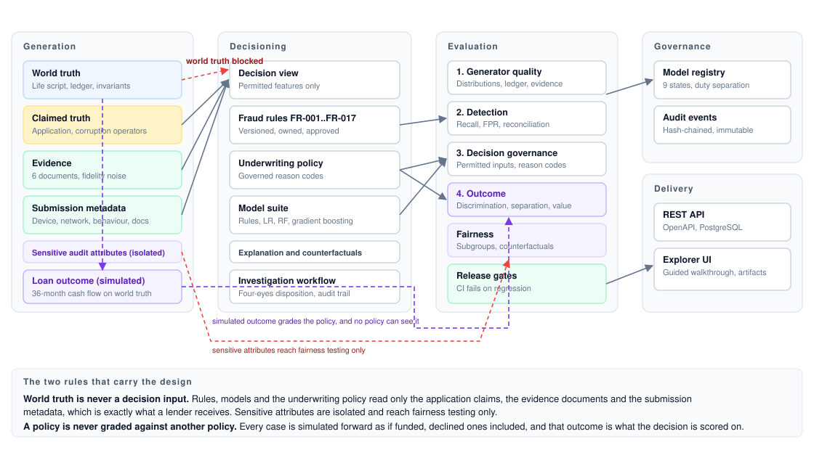

# Case Explorer

**Credit risk lab for consumer lending: synthetic applications with known ground truth, a point-of-sale solar credit lab, and a public-record case study.**

**Live site:** https://case-explorer-orpin.vercel.app (opens on the Solar prime profile; `?profile=mortgage` opens the Mortgage profile). **Findings brief:** [`docs/findings/`](docs/findings/README.md).

Lenders cannot share real applications, so the analytics that decide them are hard to build, test and defend. Case Explorer generates realistic cases with known ground truth and runs the full model lifecycle over them. Its views:

- **Lender profiles** (`src/profiles/`), chosen in the header. **Solar prime**, the default, is a point-of-sale solar lender calibrated to one public lender's filings. **Mortgage** has no calibration.
- **Case** views: world truth, claimed values, evidence, the integrity check, the decision and the simulated outcome for each case. Credit Risk Mode adds a credit-policy overlay with adverse-action reasons.
- **Portfolio** views: fairness, investigation, network analytics, decision economics and validation.
- **Credit lab** views, all under Solar prime:
  - **Dealer View**: installer-channel risk over a synthetic 10,000-loan funded book.
  - **Funding & Rates**: pricing lag, rate paths over the holding period (with 2022 Treasury windows), backbook and liquidity.
  - **Public record**: real SEC and FRED data. Every value links to its source.
  - **Findings**: three findings, each tied to its evidence, and a one-page printable brief.
  - **Policy Sandbox**: the same applications scored under the current credit policy and a candidate policy: the swap set, the change in volume and expected loss, the dealer mix, and a one-page impact summary.

Borrowers, dealers and portfolios are synthetic; only the public-record facts are real, and each one is sourced.

<p align="center">
  
</p>

---

## Banking use case

The system supports the five workflows a lending analytics function actually runs.

| Workflow | What it does here |
|---|---|
| Synthetic borrower and evidence generation | Simulates a coherent financial life, then derives the six documents a lender receives from it. |
| Fraud and adverse-scenario simulation | Injects eleven typologies with declared mechanisms, observable indicators and evidence trails. |
| Underwriting and fraud-model development | Governed splits, four modelling strategies, and metrics chosen for a rare-event problem. |
| Independent validation, fairness and stress testing | Three separate evaluation layers, counterfactual fairness testing, out-of-time and adversarial stress sets. |
| Governed deployment and performance monitoring | Model registry with lifecycle states and separation of duties, immutable audit events, drift monitoring. |

Two design rules carry the project. **World truth is never a decision input:** rules, models and the underwriting policy read only what a lender receives, which is the application claims, the evidence documents and the submission metadata. **A policy is never graded against another policy:** every case is simulated forward as if the loan were funded, and that observed performance is what the decision is scored on.

---

## Live demo

```bash
npm ci && npm run benchmark && npm run dev
```

Open the app and press **Start guided walkthrough**. Ten steps take you through one complete case:

1. Generate a borrower, 2. inspect world truth, 3. compare the applicant's claims, 4. review supporting evidence, 5. see rule and model alerts, 6. view the model explanation, 7. review fairness checks, 8. make a manual disposition, 9. open the audit record, 10. export the validation package.

The demo reads the published benchmark and model artifacts. Where an artifact is missing it says so rather than showing a number it cannot support.

---

## Verified metrics

Generated by `npm run benchmark` and the Python pipeline, then written into this file by `npm run readme:metrics`. CI fails if these tables are stale or if any mandatory release gate fails.

<!-- metrics:start -->
_Generated from `artifacts/validation-summary.json` (benchmark seed 42, 2,000 blended + 2,250 stratified cases) by `npm run readme:metrics`. Do not edit by hand._

| Capability | Result |
|---|---|
| Generated cases (benchmark run) | 4,250 |
| Ledger invariants | 100.0% |
| Evidence consistency | 100.0% |
| Distribution tests passing | 100.0% |
| Correlation targets within tolerance | 100.0% |
| Reproducibility (seeded) | 100.0% |
| Ground-truth reconciliation | 100.0% |
| Rule-baseline fraud recall / precision | 1.000 / 0.995 |
| Rule-baseline false-positive rate (clean) | 0.4% |
| Policy discrimination on outcomes (AUC) | 0.667 |
| Population bad rate / approved-pool bad rate | 7.2% / 0.0% |
| Approved-pool risk separation | 100.0% |
| False decline rate | 91.8% |
| Prohibited variables in decision inputs | 0 |
| Counterfactual fairness invariance | 100.0% |
| Coordinated-ring recall (network analytics) | 100.0% |
| Fairness checks | WARN |
| Release gates | PASS |
<!-- metrics:end -->

<!-- model-metrics:start -->
_Generated from `analytics/artifacts/model-summary.json` (governed splits from `scripts/build_datasets.js`) by `npm run readme:metrics`. Do not edit by hand._

| Model metric | Result |
|---|---|
| Champion model | random_forest (sklearn) |
| Fraud PR-AUC (held-out test) | 0.995 |
| Fraud ROC-AUC (held-out test) | 0.996 |
| Recall at selected threshold (0.20) | 0.992 |
| Precision at threshold | 1.000 |
| False-positive rate at threshold | 0.000 |
| Calibration error (ECE) | 0.034 |
| Brier score | 0.005 |
| Out-of-time PR-AUC / recall | 0.985 / 0.973 |
| Adversarial-set PR-AUC | 1.000 |
| Clean-control false-positive rate | 0.001 |
| Challenger rules_baseline PR-AUC (test) | 0.976 |
| Challenger logistic_regression PR-AUC (test) | 0.989 |
| Challenger gradient_boosting PR-AUC (test) | 0.993 |
<!-- model-metrics:end -->

Fairness reports **WARN** by design. Counterfactual invariance is exact and the independently sampled scenario attributes show no disparity, but derived attributes such as income band and persona fall below a four-fifths selection ratio. That is expected: those attributes are correlated with the legitimate financial variables the policy underwrites on. The system reports the disparity for human review instead of hiding it or gating on it.

---

## Credit analysis mode

Four views look at a point-of-sale lender's risk through the active **lender profile**, chosen in the header (`src/profiles/`). The Solar prime profile, which the app opens on, is calibrated against one public lender's filings. The Mortgage profile has no calibration, benchmarks or case studies, and stays the engine's fallback when a function is called without a profile.

| View | What it shows |
|---|---|
| **Credit Risk Mode** (toggle) | A credit policy overlay on claimed values: back-end DTI, FICO, liquidity and visible fraud alerts, with adverse-action reasons. Back-end DTI uses the payment the active profile underwrites, over gross monthly income: Mortgage adds the proposed PITI to non-housing obligations; Solar prime adds the current housing payment and the proposed solar loan payment (the case's seeded loan amount amortised at the profile's default coupon and term). Every DTI display uses that definition. It sits beside the generator's integrity check and flags the two disagreements that matter. |
| **Dealer View** (tab) | Installer-channel risk over a 10,000-loan funded book (credit-policy APPROVE loans only): fictional dealers, a binomial dealer rating, concentration alerts, and a dealer-failure loss covering both contractor advances and asset-level losses. A signal-vs-noise panel shows how many dealers the rating flags when dealer quality has no effect at all. |
| **Funding & Rates** (tab) | The pricing-lag channel: a fixed-rate loan priced at approval and sold later, the platform fee against the rate shock, the unsold backbook, a liquidity path with a minimum-liquidity covenant, the funding partner's loan cap, and portfolio expected loss. Rate paths move the yield over an uncertain holding time (triangular, 30 to 90 days, an assumption): straight-line rises and a fall, plus every 2022 business day's change in the 10-year Treasury yield over the next 30, 60 and 90 days, from the committed FRED snapshot. Treasury-only paths understate losses, because credit spreads also widened in 2022. |
| **Policy Sandbox** (tab) | What happens if the credit policy changes. The pool is every application the baseline generated to fund its 10,000-loan book (18,674 at seed 42), scored under the baseline and a candidate policy: swap-ins (not funded → funded) and swap-outs, each cell's volume, presented credit quality and expected loss, the dealer mix, and a printable impact summary. Review counts as not funded, as in the book. Swap-in losses are shown as the synthetic truth and as a conservative inferred view (swap-in PD × 1.5, an assumption), because a real lender never observes how swap-ins would have performed. |

**Calibration benchmark.** The Solar prime profile tunes only the credit score base so that applications approved under the current credit policy average a FICO of 748. That is the average reported for financed borrowers in Sunlight Financial's FY2022 Form 10-K. Loan amounts use the 10-K's disclosed $10,000–$150,000 range, with an assumed median chosen to match the disclosed $46,000 average solar loan balance. Every other distribution keeps the generator default and is uncalibrated.

**Data provenance.** Every borrower, dealer, loan outcome and portfolio is synthetic. The only real-world inputs are cited public documents: Sunlight Financial's FY2022 Form 10-K and SEC filings, a September 2022 press release, and a November 2022 letter from state attorneys general. Each fact and default input is tagged in the app as either *disclosed*, with a link to its source, or an *assumption*. Real company names appear only in `src/profiles/`, and a test enforces this.

**Public record** (tab, Solar prime profile). This tab uses real data rather than synthetic data: Sunlight Financial's SEC filings and Federal Reserve rate data, pinned at build time. It has three analyses:
- **Rates vs unit economics:** take rate against the fed funds rate.
- **Liquidity and covenants:** a cash runway timeline with sourced events.
- **Leverage and liquidity:** total liabilities ÷ total assets, cash ÷ total liabilities, and cash ÷ quarterly operating outflow, for the quarters the filings support. Gaps are listed, never estimated.

The **Findings** tab (Solar prime profile) states three findings, each with its evidence, and prints as a one-page brief. The captured images are in [`docs/findings/`](docs/findings/README.md).

Every value links to the filing, page and label it came from.

### Public record: data provenance

<!-- public-record:start -->
_Generated from `data/public-record/` by `node scripts/public-record/provenance-md.mjs --write`. Do not edit by hand._

**Company:** Sunlight Financial Holdings Inc. (CIK 1821850). Sunlight became the public registrant on July 9, 2021, when it combined with Spartan Acquisition Corp. II. Figures for periods before July 10, 2021 are the Predecessor's (Sunlight Financial LLC) and come from comparative columns in later filings; the third quarter of 2021 is shown as two stubs (Predecessor July 1–9, Successor July 10–September 30) and never combined. The SPAC's own pre-merger filings are excluded.

**How the data was obtained.** `scripts/fetch-public-record.mjs` was run once by hand, never in CI. It made at most four requests a second and stopped on any non-200 response.
- Run on 2026-10-14 with the User-Agent `Mpingo Systems [contact email redacted]`. The contact email is masked in every committed file.
- The browser never calls SEC or FRED; the app reads only the committed snapshot.

| Source | Endpoint | Retrieved (UTC) | SHA-256 | Bytes | In repository |
|---|---|---|---|---|---|
| sec-companyfacts | https://data.sec.gov/api/xbrl/companyfacts/CIK0001821850.json | 2026-10-14 22:12:11 | `1ea398e68428cc020032b879758be6ac38afffc35c05f6629edb6b70f111cc18` | 611,056 | yes |
| fred-DFF | https://fred.stlouisfed.org/graph/fredgraph.csv?id=DFF | 2026-10-14 22:12:11 | `2d3f1f50dc5effeb7d27d795228481a2b35856d4cf3ee0732cacab54f08a5798` | 424,283 | yes |
| fred-DGS10 | https://fred.stlouisfed.org/graph/fredgraph.csv?id=DGS10 | 2026-10-14 22:12:12 | `a7789b2b1ba3bf0535f02f12a6e994dffb999f87f8c7a20d4c6338ff828f48cd` | 269,043 | yes |
| filing-10q-2021q3 | https://www.sec.gov/Archives/edgar/data/1821850/000182185021000026/sunl-20210930.htm | 2026-10-14 22:12:13 | `0a6724018af5244ba80833767076180530e58fe7bb5ad190c954cd9176684049` | 3,468,770 | no (hash recorded) |
| filing-10k-2021 | https://www.sec.gov/Archives/edgar/data/1821850/000182185022000004/sunl-20211231.htm | 2026-10-14 22:12:13 | `187dd862b4044a579a28b5c51711179dddd620e9382dc58eece4117aa9381aa4` | 3,422,800 | no (hash recorded) |
| filing-10q-2022q1 | https://www.sec.gov/Archives/edgar/data/1821850/000182185022000019/sunl-20220331.htm | 2026-10-14 22:12:13 | `09b36ebf354679dd3e292366af0fbe1f421436fad8378951d029b8468d2791ef` | 2,727,177 | no (hash recorded) |
| filing-10q-2022q2 | https://www.sec.gov/Archives/edgar/data/1821850/000182185022000050/sunl-20220630.htm | 2026-10-14 22:12:14 | `7e34dea26b5e6f938c6974ab826ed925c6d5e3923f413c16a40213be5c43e410` | 3,255,073 | no (hash recorded) |
| filing-10q-2022q3 | https://www.sec.gov/Archives/edgar/data/1821850/000182185022000073/sunl-20220930.htm | 2026-10-14 22:12:14 | `abfb932951055addb4444ae10d13c42663cdf7e39feb1cfd72a026aaa106dbf5` | 3,949,852 | no (hash recorded) |
| filing-10k-2022 | https://www.sec.gov/Archives/edgar/data/1821850/000182185023000025/sunl-20221231.htm | 2026-10-14 22:12:14 | `dc2724772163a2bccfb473a484e960d872351c6f1ee9c74c673772e45d296836` | 4,116,969 | no (hash recorded) |
| filing-10q-2023q1 | https://www.sec.gov/Archives/edgar/data/1821850/000182185023000043/sunl-20230331.htm | 2026-10-14 22:12:15 | `a6f74581cd3365dcc5676272c05408831e19a4042f6feb41eca9a81cd5ddf5ad` | 2,875,394 | no (hash recorded) |
| filing-10q-2023q2 | https://www.sec.gov/Archives/edgar/data/1821850/000182185023000064/sunl-20230630.htm | 2026-10-14 22:12:15 | `3faabab72e415e2b9d413aa6e52c99d769d2c9cfc65bc801eaf0333cd7343adb` | 3,091,572 | no (hash recorded) |

- **XBRL:** Balance sheet (cash, total assets, total liabilities, equity, retained earnings, line of credit), revenue, net income, operating income and operating cash flow, from SEC XBRL company facts.
- **Manual extraction:** Funded loans (MD&A key performance measures) and platform fees, net (revenue disaggregation in the notes), typed by hand from the 10-Q and 10-K filings with page references.
- **FRED:** Effective federal funds rate (DFF) and 10-year Treasury constant-maturity yield (DGS10), daily, from FRED.

**Before EDA.**
- **XBRL company facts:** 312 concepts and 3,544 facts from 12 filings.
- **Excluded:** 3 of those filings are the SPAC's own pre-merger reports (0001213900-21-014758, 0001564590-21-029320, 0001213900-21-042745).
- **Duplicates:** most periods are reported more than once, because the same period appears again as a comparative in later 10-Qs and in the 10-K.
- **FRED:** DFF has 26,403 daily observations (1954-07-01 to 2026-10-13, 0 missing). DGS10 has 16,180 (1962-01-02 to 2026-10-13, 721 days marked missing).

| Metric | Concept | Raw facts | Pre-merger excluded | Duplicates in one filing | Duplicates across filings | Kept |
|---|---|---|---|---|---|---|
| cash | CashAndCashEquivalentsAtCarryingValue | 23 | 5 | 1 | 8 | 9 |
| totalAssets | Assets | 23 | 5 | 1 | 8 | 9 |
| totalLiabilities | Liabilities | 23 | 5 | 1 | 8 | 9 |
| equity | StockholdersEquityIncludingPortionAttributableToNoncontrollingInterest | 29 | 0 | 9 | 11 | 9 |
| retainedEarnings | RetainedEarningsAccumulatedDeficit | 23 | 5 | 1 | 8 | 9 |
| currentAssets | AssetsCurrent | 5 | 5 | 0 | 0 | 0 |
| currentLiabilities | LiabilitiesCurrent | 5 | 5 | 0 | 0 | 0 |
| debt | LineOfCredit | 16 | 0 | 1 | 7 | 8 |
| revenue | RevenueFromContractWithCustomerExcludingAssessedTax | 33 | 0 | 8 | 6 | 19 |
| netIncome | NetIncomeLoss | 37 | 4 | 8 | 6 | 19 |
| operatingIncome | OperatingIncomeLoss | 37 | 4 | 8 | 6 | 19 |
| operatingCashFlow | NetCashProvidedByUsedInOperatingActivities | 26 | 3 | 6 | 4 | 13 |

**Gaps (36).** None was filled with an estimate.

- cash: Q1 2021, Q2 2021
- totalAssets: Q1 2021, Q2 2021
- totalLiabilities: Q1 2021, Q2 2021
- equity: Q1 2021, Q2 2021
- retainedEarnings: Q1 2021, Q2 2021
- currentAssets: Q1 2021, Q2 2021, Q3 2021, Q4 2021, Q1 2022, Q2 2022, Q3 2022, Q4 2022, Q1 2023, Q2 2023
- currentLiabilities: Q1 2021, Q2 2021, Q3 2021, Q4 2021, Q1 2022, Q2 2022, Q3 2022, Q4 2022, Q1 2023, Q2 2023
- debt: Q1 2021, Q2 2021, Q2 2023
- operatingCashFlow: Q3 2021
- contractor_advances: all quarters (Not extracted: no balance labelled as contractor advances was identified in the filings; left as a gap.)
- adjusted_ebitda: all quarters (Optional; not extracted from the filings.)

**After EDA.**
- **Table:** 10 quarterly rows (Q1 2021 to Q2 2023).
- **Deduplication:** facts are deduplicated by (concept, period start, period end, form, fiscal period), keeping the latest filed. Then they are deduplicated by (concept, period start, period end) across filings, again keeping the latest filed.
- **Derived quarters:** a quarter not filed on its own is derived as year-to-date minus the previous year-to-date (Q4 = full year minus nine months). It is marked derived and cites both filings. No derivation crosses the July 2021 Predecessor/Successor break.
- **FRED:** each series is the simple mean of the daily observations dated in the quarter.
- **Restatements:** manual figures use each quarter's own 10-Q or 10-K, and later restatements are listed with the value.

- **Presentation break, platform_fees, Q2 2023:** From the Q2 2023 10-Q, "Platform fees, net" is a heading over two rows, "Platform fees" and "Platform fees from affiliate", with an unlabelled subtotal. The subtotal is used. Earlier filings print one "Platform fees, net" line whose footnote says it includes affiliate fees, and the same 10-Q's subtotal for Q2 2022 ($27,873k) equals the Q2 2022 10-Q's single line, so the subtotal is the comparable figure. The presentation changes here.

| Quarter | Reported | Derived | Stubs | Missing |
|---|---|---|---|---|
| Q1 2021 | 8 | 0 | 0 | 8 |
| Q2 2021 | 7 | 1 | 0 | 8 |
| Q3 2021 | 8 | 0 | 6 | 2 |
| Q4 2021 | 8 | 6 | 0 | 2 |
| Q1 2022 | 14 | 0 | 0 | 2 |
| Q2 2022 | 13 | 1 | 0 | 2 |
| Q3 2022 | 13 | 1 | 0 | 2 |
| Q4 2022 | 8 | 6 | 0 | 2 |
| Q1 2023 | 14 | 0 | 0 | 2 |
| Q2 2023 | 12 | 1 | 0 | 3 |

**Reconciliation.** The sum of each window's quarters is compared with the filed year-to-date figure, within $0.1M. A window that includes a derived quarter matches by construction and is marked as not independent.

| Metric | Source | Window | Result | Difference | Check |
|---|---|---|---|---|---|
| revenue | xbrl | 2021 first half (Predecessor) | match | 0 USD | independent |
| revenue | xbrl | 2022 nine months | match | 0 USD | independent |
| revenue | xbrl | 2022 full year | match | 0 USD | not independent |
| revenue | xbrl | 2023 first half | match | 0 USD | independent |
| netIncome | xbrl | 2021 first half (Predecessor) | match | 0 USD | independent |
| netIncome | xbrl | 2022 nine months | match | 0 USD | independent |
| netIncome | xbrl | 2022 full year | match | 0 USD | not independent |
| netIncome | xbrl | 2023 first half | match | 0 USD | independent |
| operatingIncome | xbrl | 2021 first half (Predecessor) | match | 0 USD | independent |
| operatingIncome | xbrl | 2022 nine months | match | 0 USD | independent |
| operatingIncome | xbrl | 2022 full year | match | 0 USD | not independent |
| operatingIncome | xbrl | 2023 first half | match | 0 USD | independent |
| operatingCashFlow | xbrl | 2021 first half (Predecessor) | match | 0 USD | not independent |
| operatingCashFlow | xbrl | 2022 nine months | match | 0 USD | not independent |
| operatingCashFlow | xbrl | 2022 full year | match | 0 USD | not independent |
| operatingCashFlow | xbrl | 2023 first half | match | 0 USD | not independent |
| funded_volume | manual | 2021 first half (Predecessor) | match | 0 USD thousands | independent |
| funded_volume | manual | 2022 nine months | match | -1 USD thousands | independent |
| funded_volume | manual | 2022 full year | match | -1 USD thousands | not independent |
| funded_volume | manual | 2023 first half | match | 0 USD thousands | independent |
| platform_fees | manual | 2021 first half (Predecessor) | match | 0 USD thousands | independent |
| platform_fees | manual | 2022 nine months | match | 0 USD thousands | independent |
| platform_fees | manual | 2022 full year | match | 0 USD thousands | not independent |
| platform_fees | manual | 2023 first half | match | 0 USD thousands | independent |

**What the data cannot support:** Loan-level performance (defaults, delinquency, prepayment by loan); Vintage curves; Dealer-level data; Anything after June 30, 2023 (no later periodic filings).
<!-- public-record:end -->

**What the app is not.** It is not a consumer report, not a credit decision tool and not a model of any lender's actual current book or terms. Dealer metrics are simulated under a set dealer-effect assumption and are not evidence about real dealers. No fair-lending or disparate-impact testing is claimed for synthetic data. Every page carries a compliance footer: *Demo only · Synthetic data · Not a consumer report · Not for credit decisions · Educational portfolio project*.

---

## Architecture

```
src/
  core/          life script, corruption operators, evidence synthesis, metadata, audit attributes
  simulation/    coordinated-ring injection
  decisioning/   fraud rules, underwriting policy, reason-code catalog, feature policy, investigation workflow
  evaluation/    generator quality, detection, decision, fairness, economics, release gates
  ml/            underwriter-visible decision view and permitted feature rows
  analytics/     entity and network analytics
  governance/    hash-chained immutable audit events
  contracts/     versioned Zod schemas enforced at every boundary
  db/            PostgreSQL store, migrations, in-memory store
  api/           Express API, controllers, services
  ui/            React explorer: theme, primitives, hooks, tabs, guided tour
analytics/       Python workbench: datasets, features, models, evaluation, explainability, fairness,
                 monitoring, governance registry, pipeline
scripts/         benchmark, dataset builder, migrations, seed, README metrics, demo assets
```

Details in [docs/ARCHITECTURE.md](docs/ARCHITECTURE.md). API reference in [docs/openapi.yaml](docs/openapi.yaml), served interactively at `/api/docs`.

---

## Statistical methodology

A Gaussian copula couples age, salary, debt-to-income, checking balance and credit score, with each marginal mapped through its own inverse CDF. A latent financial-health factor, a population regime and a geography multiplier then shape the draw, and persona selection is tied to salary rank. Income, expenses and a closed-loop monthly ledger are derived from that state, and every evidence document is produced from the ledger with a configured fidelity noise.

Every parameter carries a provenance class: empirically calibrated, simplifying assumption, stress scenario or fraud injection. Most current values are modelling assumptions, and each row names the public series it should be calibrated against. This is stated plainly rather than implied.

- [Data dictionary](docs/methodology/DATA_DICTIONARY.md)
- [Parameter sources](docs/methodology/PARAMETER_SOURCES.md)
- [Statistical assumptions](docs/methodology/STATISTICAL_ASSUMPTIONS.md)
- [Fraud scenario methodology](docs/methodology/FRAUD_SCENARIO_METHODOLOGY.md)
- [Limitations](docs/methodology/LIMITATIONS.md)

---

## Model development workflow

```bash
npm run datasets                                            # governed splits with manifests
cd analytics && pip install -e ".[dev]"
python -m case_analytics.pipeline --data data --out artifacts
```

Eight splits are produced, each with its own manifest recording dataset version, generator commit, configuration hash, seed and population regime: train, validation, held-out test, out-of-time (later originations under a rate shock), geography stress, economic-regime stress, adversarial fraud, and a clean negative control.

Four strategies are compared on identical splits: an underwriting rules baseline, logistic regression, random forest, and gradient boosting. The comparison explains why the winner wins rather than reporting that a library was imported.

Each split carries two ground-truth targets. `label__is_fraud` records which typology was actually injected. `label__defaulted` records the simulated outcome. Neither is produced by a policy. The shipped model suite predicts fraud; the default target is exported and not yet modelled.

Because fraud is rare, accuracy is not the headline. The pipeline reports precision, recall, F1, PR-AUC, ROC-AUC, false-positive and false-negative rates, specificity, expected calibration error, Brier score, the confusion matrix, performance by fraud type and by risk regime, and a full threshold sweep. For underwriting outcomes it reports approval, manual-review and decline rates, a bad-rate proxy, expected loss, false-decline rate, review workload and a customer-friction proxy.

A threshold simulator turns those into operational consequences:

```
Expected value = fraud loss avoided − false-positive review cost − customer friction cost − model operating cost
```

Fraud prevalence, average loss, review cost, false-decline cost, investigation capacity and the decision threshold are all adjustable, in the API and in the Economics tab of the demo.

---

## Validation results

Four independent evaluation layers, deliberately kept separate because they answer different questions.

| Layer | Question |
|---|---|
| Generator validation | Are the distributions correct, the financial relationships coherent, the evidence consistent, the correlations realistic, the seeds reproducible? |
| Detection evaluation | Can rules or a model identify the injected fraud, which types are missed, what is the false-positive rate, which evidence supports each alert? |
| Decision governance | Was only permissible data used, are the reason codes accurate and adverse-action eligible, does the decision hold up against the reason-code rules? |
| Outcome evaluation | Did the decision turn out to be right? Does the policy rank real defaults, is the approved pool actually safer, and what does the boundary cost? |

### Grading a policy on outcomes rather than on agreement

Every case is simulated forward over a 36 month horizon using world-truth cash flows, and the resulting performance becomes the label. That simulation reads no policy, no rule and no reason code, so it can grade them. It runs for declined applications too, because without that counterfactual a false decline cannot be measured and a policy that declines everything would look flawless.

Most of the damage from misrepresentation emerges rather than being asserted. An applicant who overstated income is underwritten on the claim but lives on the truth, so their residual income is thinner than the file suggests and they fail more often. Concealed debt is different again: it does not change the borrower's own capacity at all, it changes which borrowers get approved, and the outcome layer measures that as adverse selection into the approved pool.

This replaced a metric that compared the policy against a label the generator's own rule engine produced. That comparison scored 98.9 percent, which looked excellent and meant almost nothing: it measured whether two implementations of similar logic agreed. Graded on outcomes the same policy tells a different story. It achieves a clean approved pool and ranks real defaults, but it declines most applicants who would have paid, and on this population it captures roughly a quarter of the value an oracle could. Label agreement is still reported, as a consistency diagnostic, and is no longer gated.

`npm run benchmark` runs all three plus fairness and network analytics, writes `artifacts/` (summary JSON, Markdown report, and CSVs for distributions, correlations, reconciliation, decisions, fairness, counterfactual findings, rule analytics and network clusters), and **exits non-zero when any mandatory release gate fails**. The gates are declared in `src/evaluation/gates.js` and cover ledger invariants, evidence consistency, distribution and correlation tests, reproducibility, required fields, ground-truth reconciliation, outcome discrimination, approved-pool risk separation, prohibited-variable leakage, reason-code governance, counterfactual invariance, scenario-attribute parity and coordinated-ring recall.

---

## Fairness and governance

Data is split into three classes and the split is enforced at runtime, not by convention. Permitted features may be used to decide. Sensitive evaluation attributes are available only to fairness testing. Prohibited fields, which include everything derived from world truth, all labels and all identity, throw if they reach a model.

Fairness testing runs subgroup analysis with two-proportion tests and a deterministic counterfactual test: hold the financial profile fixed, change one sensitive attribute, and require the outcome and the reason codes to be identical. Any difference is a critical finding. This provides technical fairness-testing controls that support human legal and compliance review. It does not establish legal compliance, and the repository does not claim that it does.

Adverse-action reason codes come from a governed catalog with categories for credit risk, verification failures, fraud indicators, data-quality problems and manual-review triggers. A decline must cite at least one adverse-action-eligible code, and can never be justified by fraud indicators alone. Fraud indicators route a case to investigation instead.

The Python model registry enforces nine lifecycle states from draft to retired, and a model's developer cannot mark it validated without an explicit override that writes a segregation-of-duties audit event. Investigations follow their own state machine with four-eyes disposition approval. Every consequential action appends a hash-chained audit event, so altering history is detectable.

---

## Reproducibility

```bash
docker compose up          # postgres, migrations, seed data, API on :3000
npm run benchmark          # deterministic; same seed gives byte-identical output
npm run seed               # scored cases and investigations in the store
```

Node and Python versions are pinned in `.nvmrc` and `.python-version`, dependencies are lockfile-pinned, migrations are idempotent, and every dataset and benchmark run records its seed, configuration hash and generator commit. Seeded generation is verified byte-for-byte identical by a release gate on every run.

---

## Known limitations

Stated in full in [docs/methodology/LIMITATIONS.md](docs/methodology/LIMITATIONS.md). The most important ones:

- Most distribution parameters are hand-chosen modelling assumptions, not fitted to real data.
- Loan outcomes are simulated, not observed. That removes the circularity of grading a policy against another policy, but the hazard and loss parameters are themselves assumptions, so only the relative ordering of outcomes should be trusted, never the absolute default or loss level.
- Two typologies, synthetic identity and straw buyer, carry an asserted intent-to-default term rather than an emergent one.
- The expense model omits several essential household costs, and the down payment consumes nearly all liquid assets, so residual income is more comfortable and post-closing reserves thinner than a real borrower's. Capacity-driven defaults are rarer here than in reality.
- Fraud typologies are simplified and their metadata signals are separable by construction, which flatters detection.
- Only mortgage purchase and refinance, with the loan amount fixed at three times stated income. No property, appraisal, LTV or co-borrower modelling.
- Evidence documents are structured fields, not images or PDFs.
- Fairness attributes are synthetic scenario labels, not real protected-class data.

---

## Responsible use

This project generates synthetic data only. It must never be pointed at real borrower data, and nothing in it is suitable for making or defending a real lending decision about a real person. The fraud typologies are documented so detection can be researched and tested; they are descriptions of what fraud looks like in data, not instructions for committing it. Simulated cases are never labelled SAR-ready, because that determination is a regulated operational judgement made by people through confidential processes.

See [SECURITY.md](SECURITY.md), the [model card](docs/MODEL_CARD.md) and the [dataset card](docs/DATASET_CARD.md).

---

## Roadmap

- Calibrate the parameter set against the public series named in the parameter-source tables, and reclassify each row from assumption to empirically calibrated as that lands.
- Add property, appraisal and LTV modelling so occupancy and valuation typologies have a real subject property.
- Extend network analytics with broker and bank-account entities, and add the remaining typologies listed as not yet implemented in the fraud methodology.
- Remove the planted boolean flags so the remaining typologies must be inferred from evidence rather than read from a marker.
- Calibrate the performance hazard and loss parameters against public mortgage performance series so absolute default levels become credible, not just their ordering.
- Train a credit-risk model on the default target that the datasets now carry, alongside the existing fraud models.
- Online scoring for tree models so the API can serve the champion directly instead of falling back to the rule score.

---

## Commands

| Command | Purpose |
|---|---|
| `npm run dev` | Start the explorer UI |
| `npm run benchmark` | Authoritative validation; writes `artifacts/`, enforces release gates |
| `npm run datasets` | Build governed splits with manifests into `analytics/data/` |
| `npm test` | Unit, property, contract, integration and UI tests |
| `npm run start` | API server with interactive docs at `/api/docs` |
| `npm run db:migrate` / `npm run seed` | Apply migrations, seed scored cases and investigations |
| `npm run readme:metrics` | Regenerate the metric tables above from artifacts |
| `docker compose up` | Full stack: PostgreSQL, migrations, seed, API |

---

## License

MIT. See [LICENSE](LICENSE). Contributions welcome, see [CONTRIBUTING.md](CONTRIBUTING.md).
