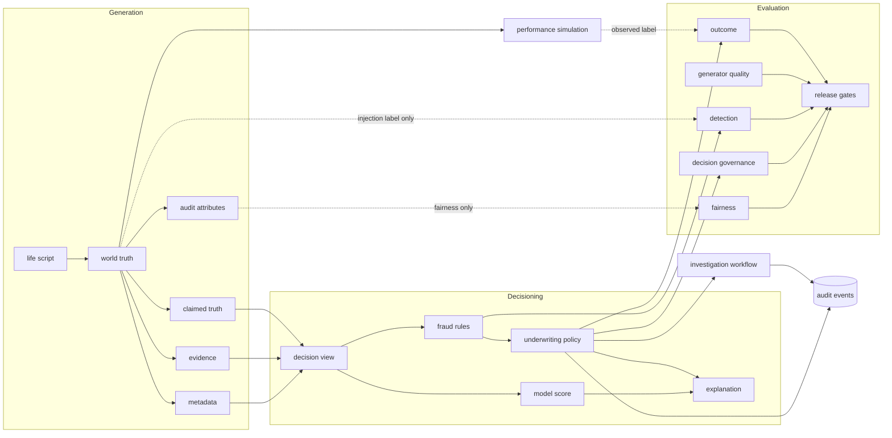

# Architecture

Case Explorer is a credit risk lab for consumer lending, built on synthetic applications with known ground truth; its mortgage fraud-analytics and model-validation suite is one part of it. It has a JavaScript core (generation, decisioning, evaluation, API, UI) and a Python analytics workbench (model development, explainability, fairness, monitoring, governance).

On top of that core sits a credit lab for consumer lending, driven by **lender profiles**: Solar prime is the default, and Mortgage stays the engine's fallback. The credit lab covers the credit policy, the Dealer View, Funding & Rates, a Public record tab built on pinned SEC and FRED snapshots, a Findings tab, and a Policy Sandbox that scores the portfolio's application pool under a candidate credit policy. Browser code never calls SEC or FRED; it reads only the committed snapshots in `data/public-record/`.

## The two central rules

Generation produces three layers plus metadata:

| Layer | Meaning | Who may read it |
|---|---|---|
| World truth | What actually happened to the borrower | Labelling and detection scoring only |
| Claimed truth | What the applicant put on the application | Decisioning |
| Evidence | The six documents a lender receives | Decisioning |
| Submission metadata | Device, network, behaviour, document ages | Decisioning |
| Audit attributes | Sensitive evaluation attributes | Fairness testing only |
| Performance | Simulated loan outcome if funded | Outcome evaluation and model targets only |

`src/ml/decision_features.js` builds the underwriter-visible view. `src/decisioning/policies/feature_policy.js` classifies every field as permitted, sensitive or prohibited and throws at runtime if a prohibited field reaches a model. Prohibited covers everything derived from world truth, every label, identity, and every field of the performance simulation, which is information about the future.

The second rule is that a policy is never graded against another policy. `src/simulation/performance.js` simulates each case forward as if the loan were funded, reading world-truth cash flows and no policy, rule or reason code. `src/evaluation/outcome/index.js` grades the underwriting policy on that outcome: does policy severity rank real defaults, is the approved pool safer than the population, how many rejected applicants would have paid, and what is the portfolio worth against approve-all, decline-all and an oracle. Performance is simulated for declined cases too, so a false decline is measurable.

Two default definitions exist. The 36-month performance simulation above gives the Mortgage measure, `performance.defaulted`, exported to the Python datasets as `label__defaulted`. The Solar prime dealer simulation in `src/dealers.js` gives, for each funded loan, `pd` and `dpd30` (30+ days past due within 18 months). The credit work uses the Solar measures: the Findings numbers, the Policy Sandbox and the loan tape in `data/credit-tape/`.

## Request and evaluation flows

## Modules

| Path | Responsibility |
|---|---|
| `src/core/` | Life-script generation, corruption operators, evidence synthesis, application metadata, sensitive audit attributes, alignment and ground-truth findings, the labelling decision engine |
| `src/utils/` | Seeded PRNG (Mulberry32 with FNV-1a hashing), distributions, copula helpers |
| `src/simulation/` | Coordinated-ring injection at batch level, and the loan-performance simulation that produces the observed outcome label |
| `src/decisioning/` | Fraud-rule catalog, underwriting policy, reason-code catalog, feature policy, investigation workflow, end-to-end scoring and explanation |
| `src/evaluation/` | Four evaluation layers (generator quality, detection, decision governance, outcome), fairness, decision economics, shared statistics, release gates |
| `src/ml/` | Decision view and permitted feature rows, legacy diagnostic feature extraction |
| `src/analytics/` | Entity and network analytics over devices, IPs, addresses, employers, documents |
| `src/governance/` | Hash-chained immutable audit events |
| `src/contracts/` | Versioned Zod schemas for every domain object and API payload |
| `src/db/` | PostgreSQL store with migrations and immutability triggers, plus an interface-compatible in-memory store |
| `src/api/` | Express app, controllers, services, middleware |
| `src/observability/` | Metrics registry with Prometheus exposition |
| `src/profiles/` | Lender profile registry (Mortgage, Solar prime): generator overrides, credit-policy inputs, benchmarks and sources. Real company names appear only here, and a source-grep test enforces it. `sunlight/` holds the public-record analyses and the Findings copy |
| `src/creditRisk.js` | Credit policy, the single back-end DTI definition (`caseDti`), adverse-action reasons, and the comparison with the integrity check |
| `src/dealers.js` | Synthetic dealers over the funded book, the binomial dealer rating, concentration, and dealer-failure loss |
| `src/fundingStress.js` | Loan pricing, CPR, platform fee, break-even rate shock, backbook, liquidity path and expected loss |
| `src/ratePaths.js` | Rate paths over an uncertain holding time (`pathFee`), triangular holding weights, and forward-looking historical yield windows; calls `platformFee` unchanged |
| `src/policySandbox.js` | Policy Sandbox engine: pool records, `decide` (assessCredit's decision on cached fields), `swapSet` with both swap-in risk views, and the dealer mix |
| `src/ui/` | React explorer: theme, primitives, hooks, tabs, guided tour, and the credit-lab views (`credit/`, `dealers/`, `funding/`, `publicRecord/`, `findings/`) |
| `data/public-record/` | Pinned SEC XBRL and FRED snapshots with a hashed manifest, manual extractions with page references, sourced events, and the daily DGS10 file for the rate paths (derived from the committed raw CSV; hashed under the manifest's `derived` list) |
| `analytics/` | Python workbench: datasets, feature policy, models, evaluation, explainability, fairness, monitoring, registry, pipeline |
| `scripts/` | Benchmark, dataset builder, migrations, seed, README metrics, demo assets, copula calibration, the manual public-record fetch, the credit-lab test scripts, the production smoke test, and the by-hand Playwright checks (`capture-findings.mjs`, `check-mobile.mjs`) |

## Data flow across runtimes

The JavaScript side generates cases and exports governed CSV splits with manifests (`scripts/build_datasets.js`). The Python side reads those splits, verifies each file against the SHA-256 in its manifest, re-enforces the same feature policy from `feature_policy.json`, and writes model artifacts. The API reads those artifacts to expose models, evaluations and validation packages. The UI reads both artifact sets to show verified numbers.

Neither runtime trusts the other's classification: the policy is exported as data and enforced independently on both sides.

## Storage

`DATABASE_URL` selects PostgreSQL; without it the API uses an in-memory store with the same interface. Migrations in `src/db/migrations/` create datasets, dataset versions, generation runs, cases, models, model versions, evaluations, validation findings, decision policies, policy versions, case decisions, decision explanations, investigations, review actions and audit events. Triggers reject UPDATE and DELETE on the append-only tables, which are audit events, case decisions, decision explanations, evaluations, review actions and dataset versions.

## Versioning

Every result is traceable to a dataset version, generator version and commit, feature schema version, configuration hash, seed, ruleset version, policy version, reason-code catalog version, feature policy version and model version. The benchmark manifest and each dataset manifest record these, and the score record attaches them to every decision.
